<div align="center">

# ✦ StudyMate AI

### A GenAI-Based Personalized Study Assistant

Turn your notes, chapters and PDFs into **summaries, answers, explanations, quizzes and flashcards** through a simple chat interface, powered by **Google Gemini**.


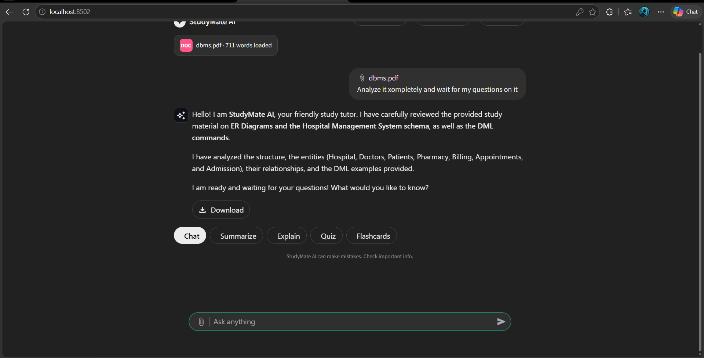

</div>

---

## 📌 Table of Contents
- [Overview](#-overview)
- [Features](#-features)
- [System Architecture](#️-system-architecture)
- [Workflow](#-workflow)
- [Screenshots](#-screenshots)
- [Tech Stack](#️-tech-stack)
- [Project Structure](#-project-structure)
- [Getting Started](#-getting-started)
- [Limitations](#️-limitations)
- [Future Scope](#-future-scope)

---

## 🎯 Overview

Students spend a lot of time reading long notes and textbooks, writing summaries and preparing self-tests by hand. **StudyMate AI** uses Generative AI to automate this. A student signs in, attaches a PDF or TXT file (or just types a question), and chats with an AI tutor that can summarize the material, answer questions about it, explain topics, generate multiple-choice quizzes with scoring, and create flashcards.

---

## ✨ Features

| Feature | Description |
|---|---|
| 🔐 **Sign up / Login** | User accounts stored in SQLite; passwords hashed with PBKDF2-SHA256 and a per-user salt |
| 💬 **AI Chat** | Conversational tutor that remembers the recent conversation |
| 📎 **PDF / TXT upload** | Attach study material from the chat box; text is extracted automatically |
| 📝 **Summarize** | Structured summary with headings, bullet points and key terms |
| 💡 **Explain** | Definition, explanation, real-world analogy and key takeaways for any topic |
| 🧠 **Quiz** | Auto-generated MCQs (structured JSON output) with instant scoring and explanations |
| 🗂️ **Flashcards** | Click-to-flip cards for active recall |
| 🕘 **Chat History** | Every chat and its material is saved per user and can be reopened or deleted |
| ⬇️ **Download** | Save any AI answer as a Markdown file |
| 🛡️ **Robust AI handling** | JSON validation, automatic fallback to a second model when one is busy, clear error messages |

---

## 🏗️ System Architecture

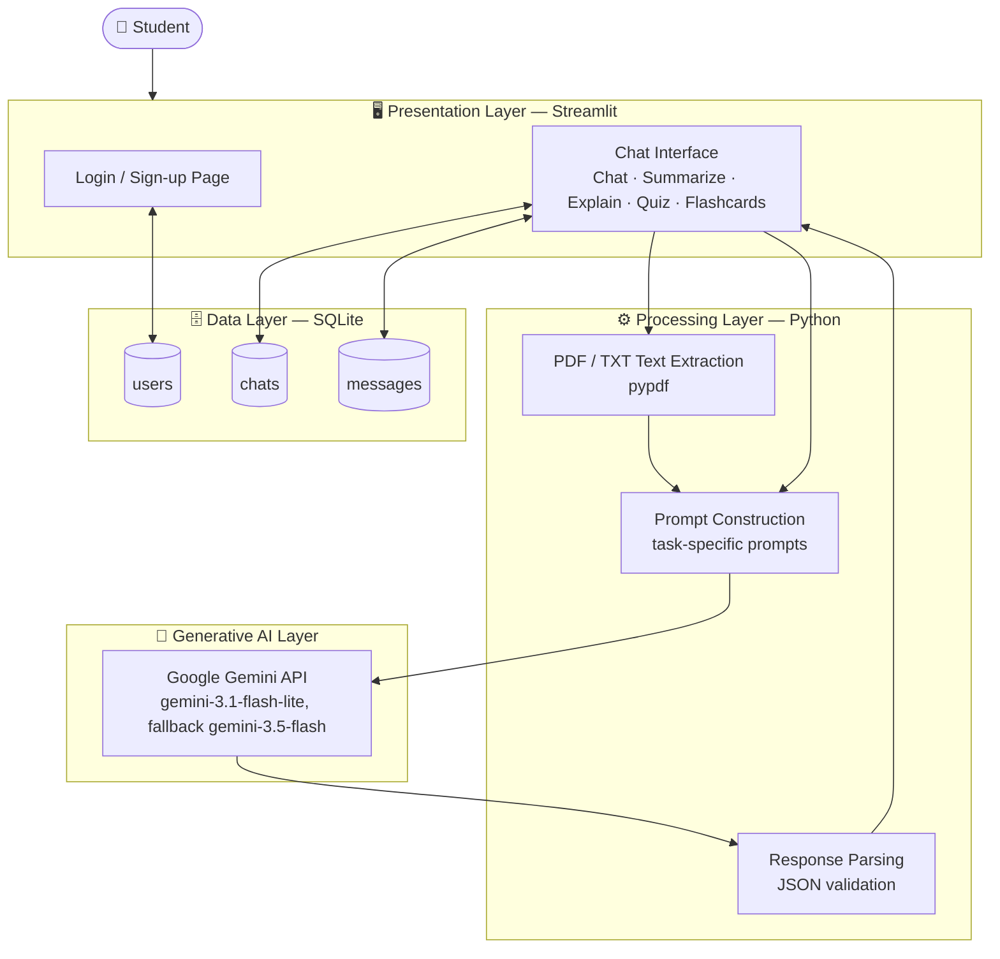

---

## 🔄 Workflow

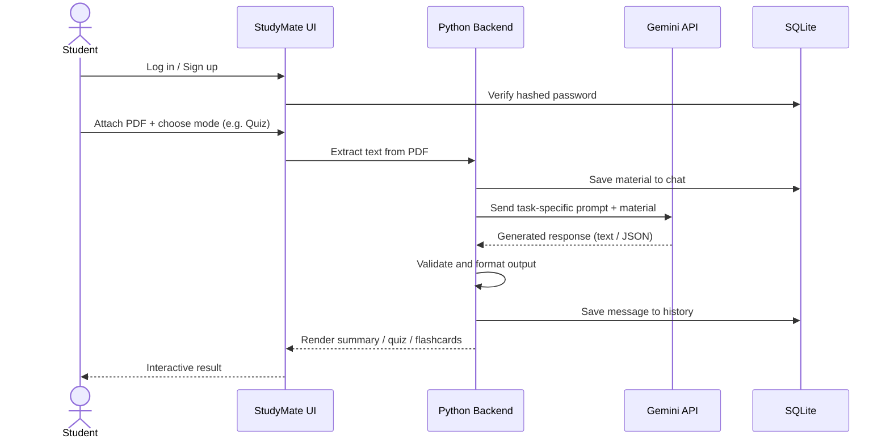

### Feature pipeline

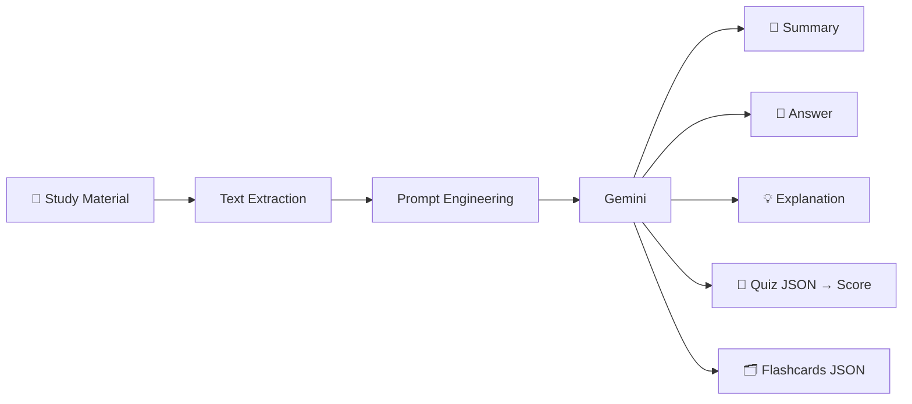

---

## 📸 Screenshots

| Sign up | Login |
|---|---|
| 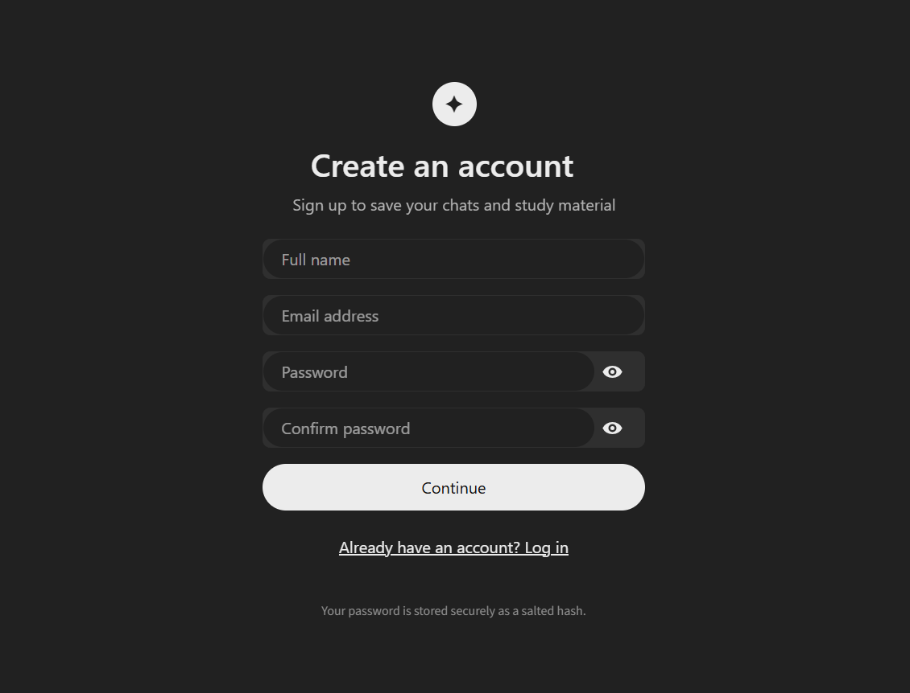 | 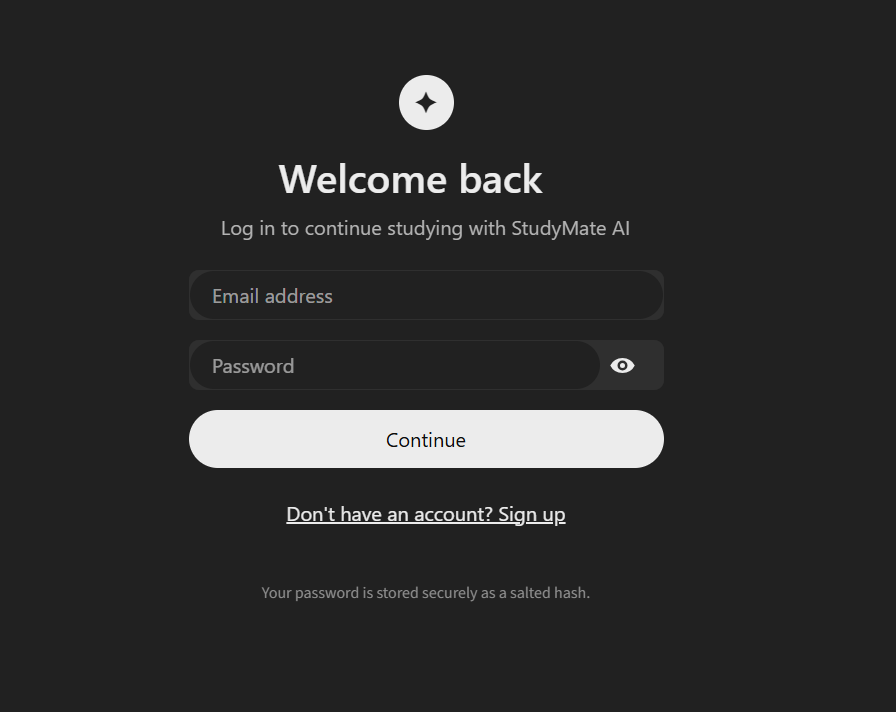 |

| Home | AI Chat |
|---|---|
| 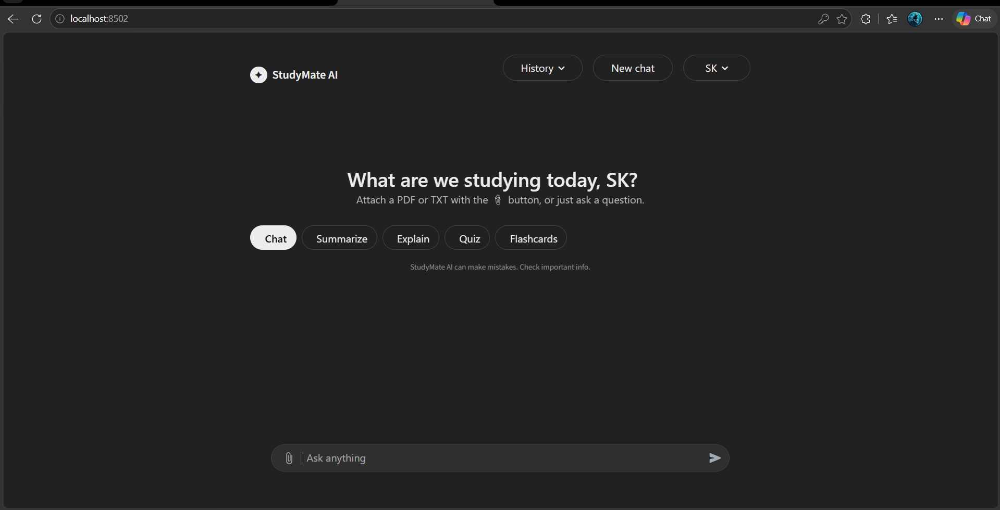 | 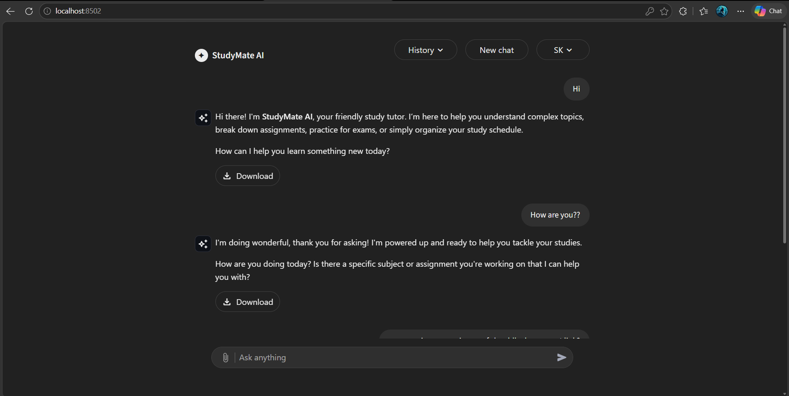 |

| PDF Upload | PDF Analysis |
|---|---|
| 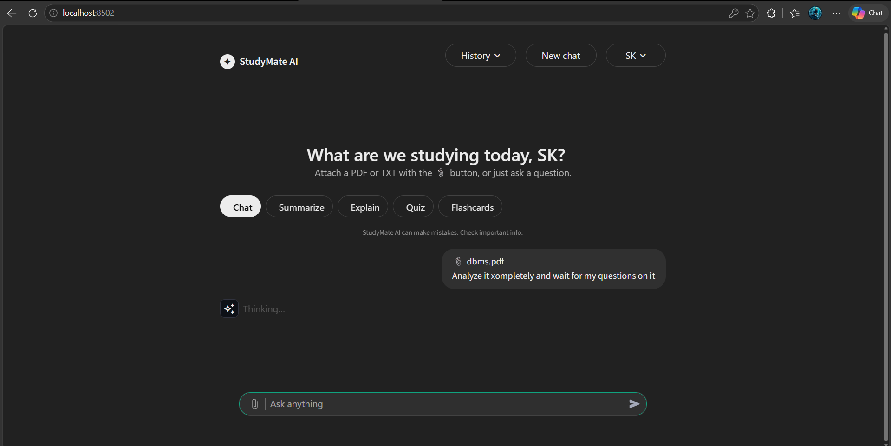 |  |

| Summary | Explain |
|---|---|
| 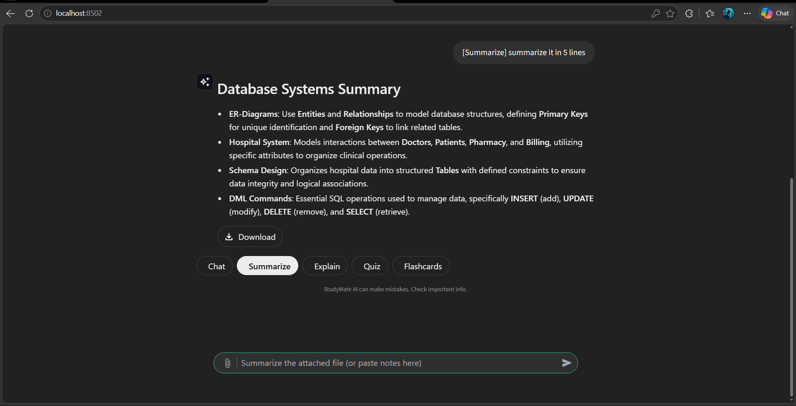 | 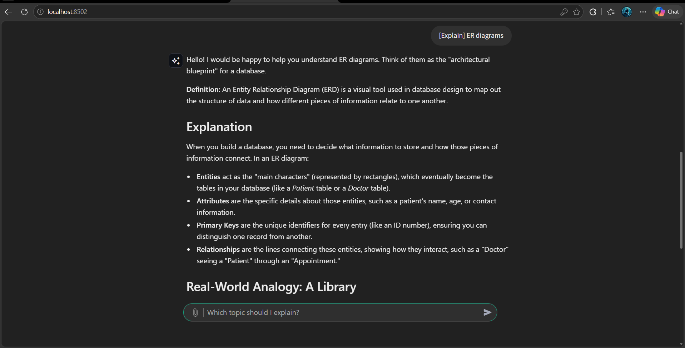 |

| Quiz | Flashcards |
|---|---|
| 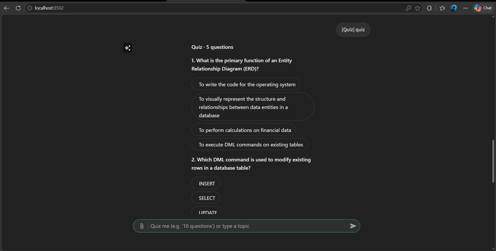 | 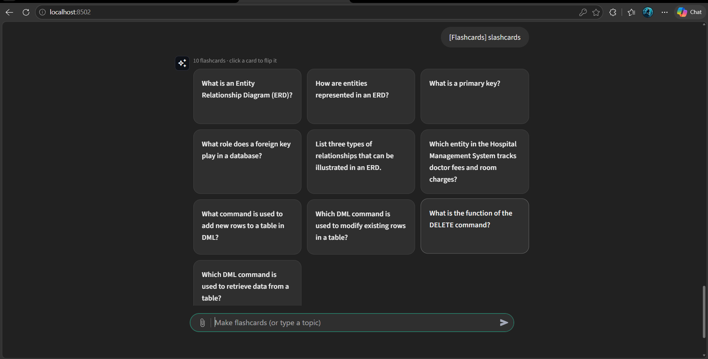 |

---

## 🛠️ Tech Stack

| Layer | Technology | Purpose |
|---|---|---|
| Language | Python 3.10+ | Core application logic |
| Frontend | Streamlit | Web UI, chat interface, custom CSS theme |
| Generative AI | Google Gemini API (`google-genai`) | Summaries, answers, explanations, quizzes, flashcards |
| PDF processing | pypdf | Text extraction from PDFs |
| Database | SQLite | Users, chats and messages |
| Security | PBKDF2-HMAC-SHA256 | Password hashing |
| Config | python-dotenv | Loads the API key from `.env` |

---

## 📁 Project Structure

```
StudyMate_AI/
├── app.py                 # Streamlit app: auth pages, chat UI, prompts, Gemini calls
├── db.py                  # SQLite storage: users, chats, messages, password hashing
├── requirements.txt       # Python dependencies
├── .env.example           # Template for the Gemini API key
├── .gitignore
├── .streamlit/
│   └── config.toml        # Dark theme
└── screenshots/           # Application screenshots
```

---

## 🚀 Getting Started

**1. Install dependencies**
```bash
pip install -r requirements.txt
```

**2. Add your Gemini API key** (free at [aistudio.google.com/app/apikey](https://aistudio.google.com/app/apikey))
```bash
copy .env.example .env      # Windows
cp .env.example .env        # macOS / Linux
```
Then edit `.env`:
```
GEMINI_API_KEY=your_key_here
```

**3. Run**
```bash
streamlit run app.py
```
Open the URL shown in the terminal (default `http://localhost:8501`), create an account and start studying.

---

## ⚠️ Limitations

- Scanned / image-only PDFs are not supported (no OCR).
- Only the first 30,000 characters of a document are sent to the AI.
- Requires an internet connection and a valid Gemini API key.
- AI output can occasionally be inaccurate — important facts should be verified.
- Refreshing the browser logs the user out; there is no password reset yet.

---

## 🔮 Future Scope

- OCR support for scanned notes and handwritten material
- RAG with chunking and vector search for very large documents
- Voice input and multilingual support
- Progress tracking dashboard with quiz score history
- Persistent sessions, password reset and email verification
- Cloud deployment

---

## 📚 References

1. Google Gemini API Documentation — https://ai.google.dev/gemini-api/docs
2. Streamlit Documentation — https://docs.streamlit.io
3. pypdf Documentation — https://pypdf.readthedocs.io
4. SQLite Documentation — https://www.sqlite.org/docs.html
5. Python `hashlib` (PBKDF2) — https://docs.python.org/3/library/hashlib.html
6. Base project: AI Study Assistant (open-source Streamlit + Gemini app), extended and redesigned for this project

<div align="center">

**StudyMate AI** · Built with Python, Streamlit and Google Gemini

</div>
